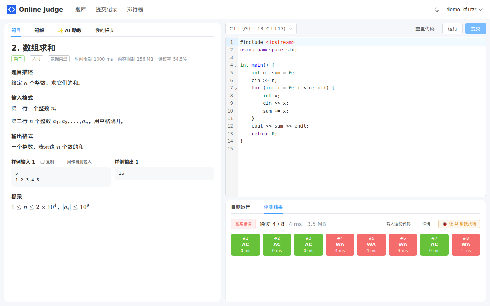
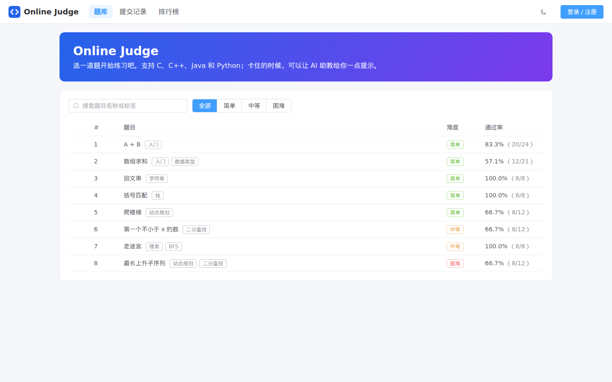
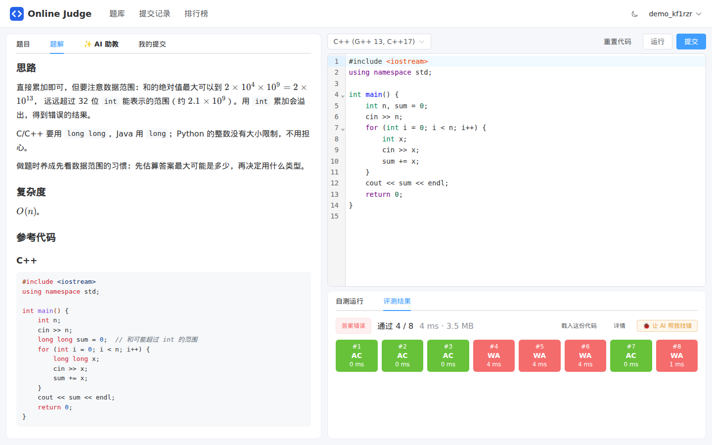
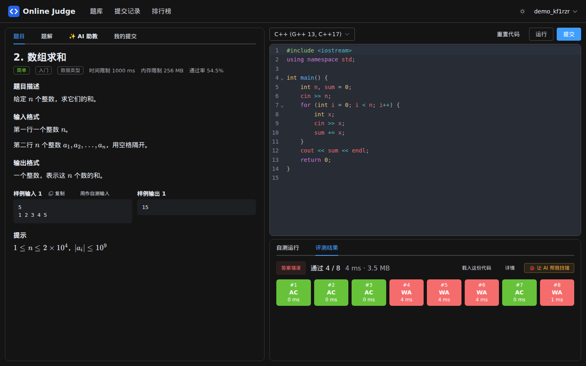

# Online Judge

一个带 **AI 助教**的在线评测系统：在网页上写代码、自动评测；做不出来的时候，可以让 AI（默认接入 DeepSeek）结合你的代码和评测结果，一步步教你写出来。



## 功能

- **题库**：难度、标签、搜索、通过率，题目列表上标出每道题的做题状态。
- **在线写代码**：支持 C、C++、Java、Python，代码高亮，按题目和语言自动保存草稿，可以用自己的输入「运行」调试。
- **自动评测**：答案正确 / 答案错误 / 运行超时 / 内存超限 / 运行出错 / 输出超限 / 编译错误，显示每个测试点的用时和内存，运行出错时给出原因（段错误、除以零……）。
- **AI 助教**：三种模式——「给点思路」只提示方向不给代码，「帮我找错」结合你的代码和最近一次评测结果找问题，「讲解题解」完整讲解并给参考代码；还可以继续追问。回答是流式输出的。
- **题解**：管理员编写的题解，查看前会先建议自己想一想或者问 AI 要提示。
- **提交记录、排行榜**，深色模式，适配手机。
- **管理后台**：题目支持 Markdown 和 LaTeX 公式（带预览），编辑样例和测试数据，可以批量导入 `1.in` / `1.out` 文件，可以先隐藏题目再公开。
- 自带 **8 道示例题**（从 A+B 到最长上升子序列），都有题解和测试数据。

| 题库 | 题解 | 深色模式 |
| --- | --- | --- |
|  |  |  |

## 快速开始

需要 [Docker](https://docs.docker.com/engine/install/)（Windows 可以在 WSL 里装：`sudo apt install docker.io docker-compose-v2 docker-buildx`）。

```bash
git clone https://github.com/Francisewais/ai-online-judge.git
cd ai-online-judge
cp .env.example .env
```

按需修改 `.env`：部署到服务器前务必把里面的密码和密钥改成随机字符串；想用 AI 助教就填上 `OJ_AI_API_KEY`（DeepSeek 的 Key 在 [这里](https://platform.deepseek.com/api_keys) 创建）。然后启动：

```bash
docker compose up -d --build
```

第一次构建要下载依赖，需要几分钟。完成后打开 <http://localhost:8080>，用 `admin` 和 `.env` 里的 `OJ_ADMIN_PASSWORD` 登录（没设置的话，随机密码打印在 `docker compose logs backend` 里）。

国内网络构建慢的话，在 `.env` 里填上镜像源（`APT_MIRROR`、`PIP_INDEX_URL`、`MAVEN_MIRROR`、`NPM_REGISTRY`，示例见 `.env.example`）。

## 架构

```
浏览器 ──> frontend（nginx + Vue 3）──/api──> backend（Spring Boot）──> MySQL
                                               │
                                               ├──> judger（FastAPI + 沙箱）   只连内部网络，不能上网
                                               └──> AI 服务（DeepSeek 等，OpenAI 兼容接口）
```

| 目录 | 说明 | 技术 |
| --- | --- | --- |
| `frontend/` | 网页 | Vue 3、TypeScript、Vite、Element Plus、CodeMirror 6、markdown-it、KaTeX |
| `backend/` | 用户、题目、提交、评测调度、AI 助教 | Java 21、Spring Boot 4、Spring Security（JWT）、JPA、Flyway、MySQL 8 |
| `judger/` | 编译并在沙箱里运行代码，比对输出 | Python 3.12、FastAPI、[QingdaoU/Judger](https://github.com/QingdaoU/Judger) 沙箱（seccomp + setrlimit） |
| `scripts/generate_seed.py` | 生成示例题目（题面、题解、测试数据） | Python |
| `tests/` | 端到端测试和模拟的 AI 服务 | Python |

接口文档（Swagger）：<http://localhost:8080/swagger-ui.html>

## 判题机和安全

提交的代码可能是恶意的，判题机做了多层隔离：

- **沙箱**：C/C++ 只允许白名单里的系统调用，Python 禁止创建进程、线程、联网和写文件；所有语言都限制 CPU 时间、内存、进程数和输出大小。
- **两个无特权用户**：编译用 `compiler`，运行用 `code`。测试数据目录只有 root 能读，程序只能拿到自己的输入；在编译期 `#include` 系统文件、运行时读取其他进程的环境变量都会失败（有对应的测试）。
- **容器**：判题机只连接一个内部网络，**不能访问外网**；根文件系统只读，只保留沙箱需要的几项权限；后端调用判题机需要令牌。
- 启动时会实际评测一次 A+B 做自检，配置有问题会直接报错退出，而不是把所有提交都判错。

Java 程序没有系统调用限制（JVM 需要多线程），靠容器隔离、进程数限制和不能联网兜底。语言版本：GCC 13（C17 / C++17）、OpenJDK 21、Python 3.12；Java 和 Python 的时间限制分别放宽为 2 倍和 3 倍。

## AI 助教

`.env` 里的相关配置：

| 配置 | 说明 |
| --- | --- |
| `OJ_AI_API_KEY` | API Key，不填则不显示 AI 功能 |
| `OJ_AI_BASE_URL` | 默认 `https://api.deepseek.com`，任何 OpenAI 兼容的接口都可以（通义千问、Kimi、本地 Ollama 等） |
| `OJ_AI_MODEL` | 默认 `deepseek-flash`，也可以用 `deepseek-v4-pro` |
| `OJ_AI_THINKING` | DeepSeek 默认开启思考模式（更慢、更贵），这里默认 `disabled`；用其他服务商时留空 |
| `OJ_AI_DAILY_LIMIT` | 每个用户每天能问几次，默认 30，管理员不限；AI 服务出错的那次不扣次数 |

发给 AI 的内容：题面、样例、官方题解（让 AI 讲得更准，但要求它不要照抄）、你当前的代码、你最近一次提交的评测结果和最近几轮对话。**隐藏的测试数据不会发给 AI**。提示词在 [`TutorPrompt.java`](backend/src/main/java/io/github/francisewais/oj/ai/TutorPrompt.java)，可以按自己的教学风格修改。

## 本地开发

```bash
# 启动数据库和判题机，并把端口暴露到本机（3306、8000）
docker compose -f docker-compose.yml -f docker-compose.dev.yml up -d mysql judger
```

- **后端**：用 IDEA 打开 `backend/`，运行 `OjApplication`，环境变量设置 `SPRING_DATASOURCE_PASSWORD`（`.env` 里的 `MYSQL_PASSWORD`）、`OJ_JUDGER_TOKEN`（`.env` 里的 `JUDGE_TOKEN`）、`OJ_ADMIN_PASSWORD`。
- **前端**：`cd frontend && npm install && OJ_BACKEND=http://localhost:8080 npm run dev`，打开 <http://localhost:5173>。

测试：

```bash
# 判题机：34 个用例，覆盖各语言的各种结果和沙箱拦截
docker compose exec judger python tests/test_judger.py
# 沙箱自带的测试（需要可执行的 /tmp，所以单独起一个容器）
docker run --rm --entrypoint sh oj-judger -c 'mkdir -p /judger/log && cp -r /opt/sandbox/tests /tmp/t && cd /tmp/t/Python_and_core && python test.py'
# 端到端：用模拟的 AI 服务把整个系统测一遍，包括所有示例题的标准解法都要 AC
docker compose -f docker-compose.yml -f docker-compose.test.yml up -d --build
python3 tests/e2e_test.py
```

后端单元测试在构建镜像时自动运行。修改示例题目：编辑 `scripts/generate_seed.py` 后运行 `python3 scripts/generate_seed.py`，示例题只在第一次启动、数据库里还没有题目时导入。

## 部署到服务器

1. `.env` 里的 `MYSQL_PASSWORD`、`MYSQL_ROOT_PASSWORD`、`JUDGE_TOKEN`、`OJ_JWT_SECRET` 都改成随机字符串（`openssl rand -hex 32`），设置 `OJ_ADMIN_PASSWORD`。
2. 设置 `OJ_BIND=0.0.0.0` 让外部可以访问，或者保持只监听本机、在前面加一层 Caddy / nginx 配置 HTTPS（推荐）。
3. 判题会占用 CPU，同时评测数量由 `JUDGE_CONCURRENCY` 控制（默认 4），建议不超过 CPU 核数。数据库数据在 Docker 卷 `oj_mysql-data` 里，记得备份。

## 许可证

本项目使用 [MIT License](LICENSE)。`judger/sandbox/` 来自 [QingdaoU/Judger](https://github.com/QingdaoU/Judger)，使用 [SATA License](judger/sandbox/LICENSE)，在原版基础上做了这些修改：

- CPU 时间统计改为用户态 + 内核态；
- `general` 规则禁止 `clone3`（新版 glibc 创建线程、进程会先用它，原规则只禁止了 `clone`）；
- C/C++ 白名单增加 `mremap`、`madvise`、`readlinkat`（新版 glibc 的 `realloc` 和静态链接程序会用到）；
- 测试代码适配 Python 3.12。
